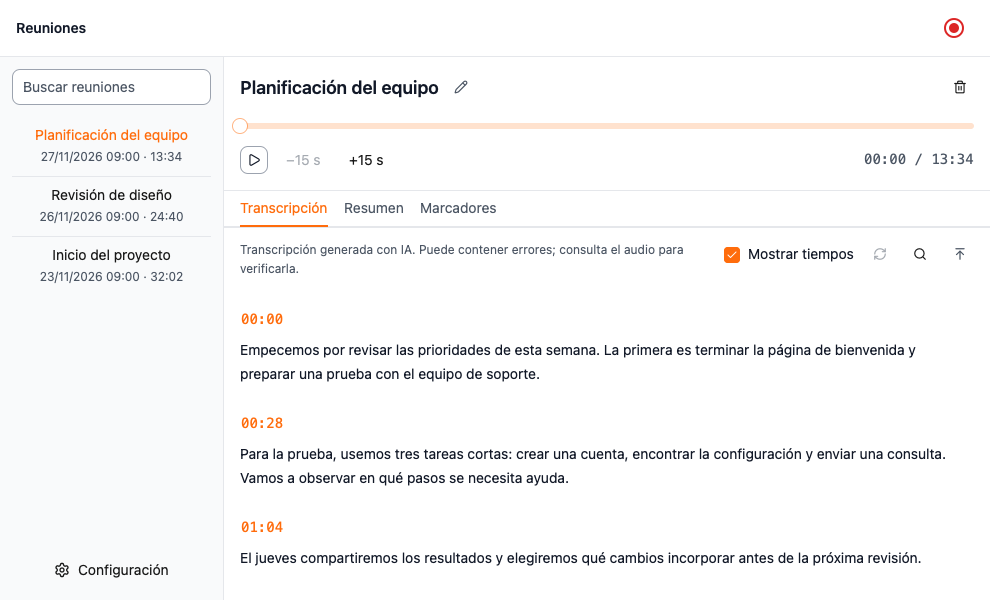
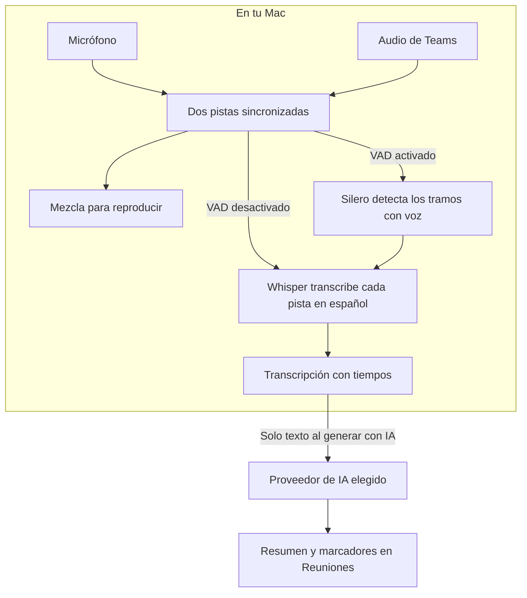

# Reuniones

Reuniones graba el micrófono y el audio de Microsoft Teams en macOS. Transcribe en español en tu Mac y te permite saltar a la grabación desde el texto, un resumen o un marcador.

[Descargar Reuniones 0.1.3 para Apple Silicon](https://github.com/kevinvargasl/teams-notes-app/releases/download/0.1.3/Reuniones-0.1.3-macos-arm64.zip)



## Descargar e instalar

El ZIP requiere un Mac con Apple Silicon (M1 o posterior) y macOS 14.2 o posterior. Para grabar, usa Microsoft Teams de escritorio.

1. Descomprime el ZIP y mueve `Reuniones.app` a **Aplicaciones**.
2. Abre la app. Esta versión tiene firma local y no está notarizada por Apple.
3. Si macOS bloquea la apertura, ve a **Configuración del Sistema → Privacidad y seguridad**, pulsa **Abrir de todos modos** (o **Abrir igualmente**) y confirma con **Abrir**.

Después de autorizarla, macOS guarda la app como excepción para las siguientes aperturas. [Instrucciones de Apple](https://support.apple.com/es-lamr/102445).

### Permisos de grabación

Al iniciar la primera grabación, permite el acceso al micrófono y al audio del sistema. Si lo denegaste, activa **Reuniones** en **Configuración del Sistema → Privacidad y seguridad**:

- **Micrófono:** permite grabar tu voz.
- **Grabación de pantalla y del audio del sistema:** permite capturar el audio de Teams. Si macOS ofrece permisos separados, basta con autorizar el audio del sistema; la app no graba la pantalla.

Si macOS pide cerrar y volver a abrir la app para aplicar un permiso, hazlo antes de grabar. [Permisos de micrófono](https://support.apple.com/es-lamr/102071) y [audio del sistema](https://support.apple.com/es-es/guide/mac-help/mchld6aa7d23/mac).

## Primer uso

1. Entra a la llamada en Teams y pulsa **Grabar** en Reuniones. Concede los permisos que solicite macOS.
2. Pulsa **Detener** al terminar. La app guarda la grabación y la transcribe si ya están instalados los modelos necesarios.
3. Puedes descargar Whisper (unos 547 MiB) antes o después de grabar, desde **Configuración → Transcripción**. Para una reunión ya guardada, abre su pestaña **Transcripción** y pulsa **Transcribir** si sigue pendiente. Si activas la detección de voz, descarga también Silero VAD (menos de 1 MiB) desde la misma sección.
4. Para generar resúmenes o marcadores con IA, instala la CLI de Codex, GitHub Copilot o Claude Code e inicia sesión en ella. Luego selecciónala en **Configuración → Inteligencia artificial**.

La grabación se inicia y se detiene manualmente. Mantén la aplicación abierta hasta que termine de transcribir o generar contenido.

## Cómo funciona



## Funcionalidades

### Grabación

- Captura simultánea del micrófono y del audio de Teams, también con auriculares.
- Pistas separadas y sincronizadas, más una mezcla para reproducirlas juntas.
- Pausa, reanudación, contador de tiempo e indicadores de señal.
- El botón de micrófono silencia tu voz únicamente en la grabación de Reuniones.
- Avisos si no hay señal o se interrumpe la captura.
- Guardado del audio pendiente al salir de la aplicación.

Se usa el micrófono predeterminado de macOS. Silenciarte en Teams no detiene la grabación de tu voz en Reuniones.

### Biblioteca

- Lista con nombre, fecha, hora local de grabación y duración. Puedes pulsar la reunión seleccionada para cerrar su detalle.
- Cambio de nombre y eliminación con confirmación. Eliminar una reunión borra todos sus archivos.
- Reordenación por arrastrar y soltar; el orden personalizado se conserva entre sesiones.
- Búsqueda por nombre o contenido de la transcripción, sin distinguir mayúsculas y minúsculas.

El buscador no filtra resúmenes, marcadores ni fechas. La reordenación se desactiva mientras hay una búsqueda activa.

### Reproducción

- Reproducir, pausar, avanzar o retroceder 15 segundos y cambiar la posición desde la barra de progreso.
- Saltar al audio desde un tiempo de la transcripción, una referencia del resumen o un marcador.

### Transcripción

- Procesamiento local en español con Whisper large-v3-turbo (`q5_0`) y aceleración mediante la GPU del Mac.
- Texto seleccionable con tiempos por párrafo que puedes ocultar.
- Búsqueda con `⌘F`, resaltado de coincidencias y navegación con `Enter` y `Mayús+Enter`.
- Regeneración desde los audios guardados, con confirmación. La transcripción anterior se conserva si el proceso falla.

Las pistas de micrófono y Teams se transcriben por separado y se combinan en orden cronológico. No se identifica a cada participante. La transcripción puede contener errores; consulta el audio para verificarla.

Al regenerar correctamente una transcripción, se retira el resumen anterior porque sus referencias pueden cambiar. Se conservan los marcadores manuales y se ejecutan las automatizaciones activadas.

### Resúmenes

- Resumen con decisiones, tareas y preguntas abiertas. Solo se incluyen responsables y fechas mencionados en la conversación.
- Referencias de tiempo para escuchar el audio que respalda cada punto; las referencias adicionales se pueden desplegar.
- Texto seleccionable y edición del texto principal.
- Regeneración con confirmación antes de reemplazar el resumen y sus ediciones.

### Marcadores

- Creación manual durante la grabación o en la posición actual del audio.
- Generación con IA de los temas principales, usando tiempos de la transcripción.
- Cambio de nombre y eliminación individual con confirmación.
- Regeneración con confirmación: reemplaza los marcadores generados y conserva los manuales y los que hayas renombrado.

La generación con IA requiere una transcripción con diálogo. Si no hay temas identificables, puede no crear marcadores.

## Configuración

- **Apariencia:** temas claro y oscuro.
- **Herramienta de IA:** Codex, GitHub Copilot o Claude Code. Cada CLI gestiona su autenticación y el acceso de la cuenta.
- **Modelo y esfuerzo de razonamiento:** opciones guardadas por herramienta. Con **Predeterminado de la herramienta**, la app no envía un valor explícito.
- **Instrucciones de generación:** editores independientes para el enfoque y el detalle del resumen y de los marcadores. Permiten guardar, cancelar o restablecer las instrucciones predeterminadas.
- **Automatizaciones:** resúmenes y marcadores automáticos, activables por separado. Se ejecutan después de guardar y transcribir; si activas ambos, primero se genera el resumen. Al cambiar de herramienta de IA, se desactivan.
- **Modo de transcripción:** Greedy prioriza la velocidad; Beam Search explora más alternativas y puede tardar más.
- **Detección de voz (VAD):** desactivada por defecto. Silero detecta los tramos con voz para omitir silencios y conservar los tiempos originales. Puede aumentar el tiempo de transcripción.
- **Reducir ruido del micrófono:** filtro local de nnnoiseless basado en RNNoise, activado por defecto. El modelo viene incluido y la opción se aplica al micrófono en las próximas grabaciones.

Las preferencias se conservan entre sesiones. Los cambios de instrucciones, modo de transcripción y VAD se aplican a las próximas generaciones, sin modificar los resultados guardados. Restablecer instrucciones cambia el borrador del editor; debes guardar para aplicarlo.

## Atajos

| Atajo | Acción |
| --- | --- |
| `⌘Q` | Salir de Reuniones. |
| `⌘⇧M` | Añadir un marcador durante la grabación o en la posición actual del audio. |
| `⌘F` | Abrir el buscador de la transcripción. |
| `⌘G` / `⌘⇧G` | Ir a la siguiente o anterior coincidencia. |
| `Esc` | Cerrar el buscador de la transcripción. |
| `⌘⌥↑` | Subir la reunión enfocada en la lista. |
| `⌘⌥↓` | Bajar la reunión enfocada en la lista. |

La reordenación por teclado requiere que el buscador esté vacío.

## Archivos y privacidad

En **Configuración → Grabación y archivos → Abrir en Finder** puedes abrir la carpeta `meetings`.

```text
~/Library/Application Support/Reuniones/
├── settings.json                  # Preferencias, instrucciones y orden de reuniones
├── ggml-large-v3-turbo-q5_0.bin     # Modelo de Whisper
├── ggml-silero-v5.1.2.bin           # Modelo de VAD, si se ha descargado
└── meetings/
    └── <id>/
        ├── meeting.json           # Datos, transcripción, resumen y marcadores
        ├── mic.wav                # Micrófono
        ├── teams.wav              # Audio de Teams
        └── meeting.wav            # Mezcla para reproducción
```

La grabación y la transcripción se procesan en tu Mac. Una vez descargados los modelos, no necesitan conexión a Internet. Las descargas se verifican mediante SHA-256.

Para generar resúmenes o marcadores, la app envía al proveedor de IA la transcripción con sus referencias o tiempos. No envía el audio ni extrae los tokens de las CLI.

## Desarrollo

Reuniones está desarrollada con Rust y GPUI Kit y utiliza `whisper-rs` para transcribir. Para compilar, instala Rust con Cargo, las herramientas de línea de comandos de Xcode y CMake.

Desde la raíz del repositorio, ejecuta:

```sh
./scripts/bundle-macos
open target/Reuniones.app
```

El script crea una aplicación firmada localmente. Usa `./scripts/bundle-macos --debug` para compilar en modo de desarrollo. Si defines `CARGO_TARGET_DIR`, el paquete se genera en ese directorio.

Si instalaste Rust con `rustup` y la terminal no encuentra `cargo`, carga su entorno con `source "$HOME/.cargo/env"`.

### Verificaciones

```sh
cargo fmt --check
cargo clippy --all-targets --all-features --locked -- -D warnings
cargo test --all-targets --all-features --locked
```

## Licencia

[MIT](LICENSE). Permite usar, modificar y redistribuir el código, incluido el uso comercial, conservando el aviso de copyright y la licencia. Las dependencias mantienen sus propias licencias.
